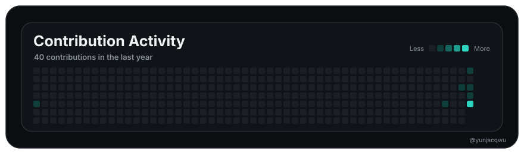
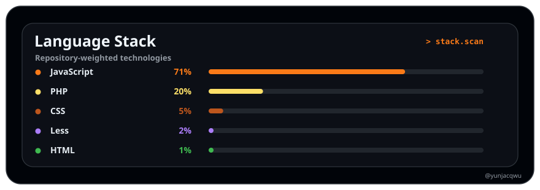

VOL. 2026 · No. 25 · Jakarta, Indonesia · <a href="https://github.com/yunjacqwu">github.com/yunjacqwu</a>

# The bbrian Times

<b>FRONTEND OR FULL-STACK ENGINEER</b> · ALL THE CODE THAT'S FIT TO SHIP

---

## 📰 What teams can evaluate quickly

<table width="100%">
<tr>
<td width="33%" valign="top">
<h3>Role fit</h3>

Frontend or full-stack engineer · JavaScript · PHP · CSS

</td>
<td width="33%" valign="top">
<h3>Public proof</h3>

10 repositories · 0 stars

</td>
<td width="33%" valign="top">
<h3>Momentum</h3>

25 contributions · 8 active days · 3 day streak

</td>
</tr>
</table>

## ✍️ Editorial

> *Tidur yang paling enak cuma tidur yang ketiduran.*

## 📈 Activity forecast

  

---

## 🚀 Infrastructure shipped

<!-- REPOS:START -->
- **[yunjacs-shoe-website](https://github.com/yunjacqwu/yunjacs-shoe-website)** — Build Shoe Website with HTML, CSS, JS, PHP, MYSQL (Work In Progress)
- **[inventory-app](https://github.com/yunjacqwu/inventory-app)** — Aplikasi web untuk mencatat stok dan pemakaian barang kendaraan
- **[Sistem-Verifikasi-Pensiunan](https://github.com/yunjacqwu/Sistem-Verifikasi-Pensiunan)** — Aplikasi web untuk verifikasi kelangsungan hidup pensiunan Dana Pensiun Pegawai Perum Peruri
- **[personal-portfolio](https://github.com/yunjacqwu/personal-portfolio)** — Personal portfolio website built with Next.js and TypeScript.
- **[Security-Report](https://github.com/yunjacqwu/Security-Report)** — Aplikasi pelaporan keamanan dan kebersihan berbasis web
<!-- REPOS:END -->

## 🛠️ Platform toolkit

<code>yunjacqwu@github:~$ toolbox --list</code>

  

---
